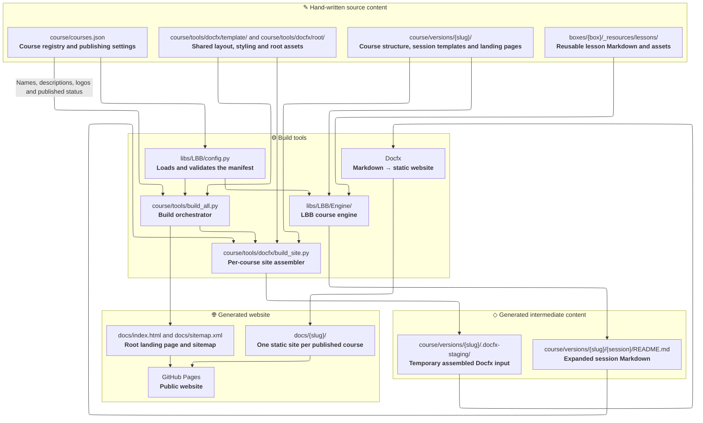
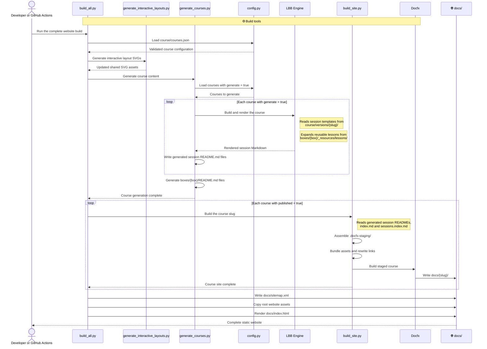

# Authoring and publishing LBB course sites

This is the practical guide for working on the LBB course documentation sites: building them locally, adding new sessions, and shipping a new course.

The sites live at `https://noblackboxes.github.io/LastBlackBox/<slug>/` (e.g. [`/crick/`](https://noblackboxes.github.io/LastBlackBox/crick/)). The complete build has five stages, described below. Its core content pipeline has two steps:

1. The **LBB engine** ([libs/LBB/Engine/](../../../libs/LBB/Engine/)) reads `_resources/template.md` for every session, expands `{Box:Lesson}` tags into the relevant lesson content pulled from [boxes/](../../../boxes/), and writes the rendered `README.md` for each session.
2. **docfx** wraps those READMEs in a static site using a shared template under [template/](template/).

## Architecture



### Build sequence



The [deployment workflow](../../../.github/workflows/deploy-docs.yml) runs `build_all.py` for pull requests and configured deployment branches. Pull requests only validate the build; pushes to `master` and, temporarily, `course-sites` deploy it to GitHub Pages.


## Local development

### One-time setup

The build requires Python 3, the .NET 8 SDK, and docfx. It uses only Python's standard library, so no `pip install` step is needed.

On Ubuntu 26.04, install the .NET 8 SDK from Canonical's backports repository:

```bash
sudo add-apt-repository ppa:dotnet/backports
sudo apt update
sudo apt install dotnet-sdk-8.0
```

For other systems, follow the official [.NET installation guide](https://learn.microsoft.com/dotnet/core/install/).

Install docfx as a global .NET tool:

```bash
dotnet tool install -g docfx --version 2.81.0
```

If your shell cannot find `docfx`, add the .NET tools directory to the current session:

```bash
export PATH="$PATH:$HOME/.dotnet/tools"
```

Verify the installation:

```bash
python3 --version
dotnet --version
docfx --version
```

### Build everything

```powershell
uv run --no-project python course/tools/build_all.py
```

Output lands at `docs/<slug>/` (e.g. `docs/crick/`), with `docs/index.html` (landing page) and `docs/sitemap.xml` at the root. The script has five stages: interactive SVGs, engine READMEs, per-slug docfx sites, master sitemap, root assets. PYTHONPATH for the LBB import is set automatically.

`uv run --no-project` bypasses the Microsoft Store Python shim on Windows. On Linux / Mac, plain `python course/tools/build_all.py` is fine.

### Build just one course (faster iteration)

```powershell
uv run --no-project python course/tools/docfx/build_site.py crick
```

Skips Stage 0 (SVGs) and Stage 1 (engine READMEs); assumes those are already up to date. Use when only touching docfx config or template files for one course.

### Serve locally

```powershell
uv run --no-project python -m http.server -d docs 8000
```

Then [http://localhost:8000/](http://localhost:8000/). Stop with `Ctrl+C`.


## Authoring course content

### Anatomy of a session

A session lives at `course/versions/<slug>/[0-9][0-9]_<session-slug>/` and needs **one** hand-written file:

```
course/versions/<slug>/
  01_my-session/
    _resources/
      template.md       # hand-written; you edit this
    README.md           # auto-generated; do not edit by hand
```

`_resources/template.md` follows this shape:

```markdown
# Course Name : My Session

One-line description for the session.

## A topic

Body text, then a tag to embed a lesson:

{Electrons:Voltage}

More body text. Another tag:

{Sensors:Photodiodes}
```

The engine replaces each `{BoxName:LessonName}` tag with the full content of `boxes/<box>/_resources/lessons/<LessonName>.md`, plus any paired `.csv` materials file. The rendered `README.md` is written alongside `_resources/`.

### The `{Box:Lesson}` tag grammar

- **BoxName** — matches a folder under [boxes/](../../../boxes/), case-insensitive (`Electrons`, `Sensors`, `Audio`, etc.).
- **LessonName** — matches an `.md` file under `boxes/<box>/_resources/lessons/`. For example, `{Electrons:Voltage}` pulls `boxes/electrons/_resources/lessons/Voltage.md`.
- A matching `.csv` (e.g. `Voltage.csv` in the same dir) is treated as session-specific materials and merged into the per-session materials table.

You never modify the generated README directly; rebuild from the template.

### Regenerating session READMEs

After editing any `template.md`:

```powershell
uv run --no-project python course/tools/engine/generate_courses.py
```

Or just run `build_all.py`, which does this as Stage 1.


## Adding a new course

End-to-end procedure for a course slug that doesn't yet exist.

### 1. Author the session content

Create `course/versions/<slug>/[0-9][0-9]_<session-slug>/_resources/template.md` for each session. Sessions are sorted by their `NN_` numeric prefix.

### 2. Register the course

Add one entry to the single course manifest, [course/courses.json](../../courses.json):

```json
{
  "name": "Your Course",
  "engine_name": "Your Course",
  "slug": "your-course",
  "description": "One sentence shown on the root landing page.",
  "logo": null,
  "generate": true,
  "materials": false,
  "published": true
}
```

The fields have distinct responsibilities:

- `name`, `description`, and `logo` define the course tile on the root landing page. Put a logo under `course/tools/docfx/root/` and store its filename in `logo`, or use `null` for no logo.
- `engine_name` is the name passed to the LBB engine and materials scripts.
- `slug` must match exactly one directory under `course/versions/` and becomes the website path under `docs/`.
- `generate` includes the course when generating session READMEs.
- `materials` includes it in the BOM and packing scripts.
- `published` includes it in the Docfx build, sitemap, and root landing page.

Every directory under `course/versions/` must have exactly one manifest entry. A published or materials-enabled course must also have `generate` set to `true`; the manifest loader validates these rules.

### 3. Customise the Docfx landing pages

For a customised course site, add these files under `course/versions/<slug>/`:

- **`index.md`** — the per-course landing page. Linked from the root site landing page. See [../../versions/crick/index.md](../../versions/crick/index.md) as a model.
- **`sessions.index.md`** — the sessions overview, linked from the top-nav. See [../../versions/crick/sessions.index.md](../../versions/crick/sessions.index.md).

Both are plain Markdown. Use repo-relative paths for images (`/course/_resources/...`) and session-relative paths for session links (`sessions/01_my-session/README.md`). If either file is absent, `build_site.py` generates a basic version from the course slug and discovered sessions.

The shared [template/](template/) provides `docfx.json.tmpl`, `toc.yml`, and the shared CSS/JS. `build_site.py` generates `sessions.toc.yml` from the discovered sessions. Override these defaults by adding `docfx.json`, `toc.yml`, `sessions.toc.yml`, or files under `template/` to `course/versions/<slug>/`.

The manifest automatically controls engine registration, the published build list, and the course tile on the root landing page.

### 4. Build, verify, ship

```powershell
uv run --no-project python course/tools/build_all.py
uv run --no-project python -m http.server -d docs 8000
```

Open [http://localhost:8000/your-course/](http://localhost:8000/your-course/) and confirm:

- Landing page renders with the right title and session links.
- Each session opens and its lesson tags expanded correctly.
- The root [http://localhost:8000/](http://localhost:8000/) shows your new tile and links into the course.

Then open a pull request. CI builds the complete site without deploying it. Pushes to `master` and, temporarily, `course-sites` deploy to Pages.


## CI deployment

[.github/workflows/deploy-docs.yml](../../../.github/workflows/deploy-docs.yml) runs `build_all.py` for every pull request. Pull requests validate and upload the generated site artifact but do not deploy. Pushes to `master` and the temporary `course-sites` preview branch publish `docs/` to Pages. The repo also needs:

- **Settings → Pages → Source = "GitHub Actions"** (one-time)
- **Settings → Environments → github-pages → Deployment branches** allows `master` (default). Add any other branch you want to deploy from while developing.


## Output anatomy

After a full build:

```
docs/
  index.html                # root landing page (course tiles)
  *.svg, *.png              # root images, when present
  robots.txt                # root assets
  sitemap.xml               # master sitemap-index
  <slug>/                   # one subtree per course
    index.html              # course landing page (rendered from index.md)
    sitemap.xml             # per-course sitemap
    sessions/
      01_.../README.html
      02_.../README.html
      ...
    _assets/                # bundled images, etc.
    public/                 # docfx CSS/JS/search
```

Everything in `docs/` is generated. The directory is gitignored.


## File reference

| File | Hand-written? | Notes |
|---|---|---|
| `course/versions/<slug>/<NN>_*/_resources/template.md` | Yes | Session template with `{Box:Lesson}` tags. |
| `course/versions/<slug>/<NN>_*/README.md` | No | Generated by the engine. |
| `course/versions/<slug>/index.md` | Optional | Custom per-course landing page; generated when absent. |
| `course/versions/<slug>/sessions.index.md` | Optional | Custom sessions overview; generated when absent. |
| `course/versions/<slug>/docfx.json` | Optional | Override the template default. |
| `course/versions/<slug>/sessions.toc.yml` | Optional | Override the template default. |
| `course/courses.json` | Yes | Register courses and control generation, publishing, landing-page text, and logos. |
| `course/tools/docfx/root/index.html` | Rarely | Root landing-page template; course tiles come from the manifest. |
| `course/tools/docfx/root/*.svg`, `*.png` | Yes | Root assets, including per-course logos. |
| `course/tools/docfx/template/` | Rarely | Shared defaults: `docfx.json`, `toc.yml`, CSS/JS. |
