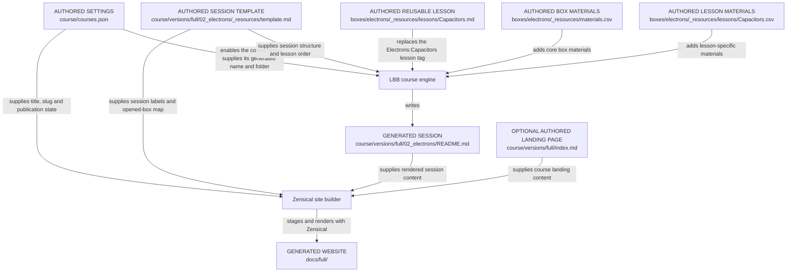

# Course content engine

The engine assembles each course session from an authored session template and
reusable lessons. It writes the generated session `README.md` files used on
GitHub and by the website build.

## What is authored, included and generated

### Repository terms

- **Central course list** — `course/courses.json`. It connects each course's
  name to its folder slug (the short folder and URL name, such as
  `braitenberg`) and controls generation, materials processing and publication.
  It contains build settings, not teaching content.
- **Course directory** — for example `course/versions/braitenberg/`. Although
  the parent directory is historically named `versions`, each slug directory is
  treated as one course by the engine and website builder.
- **Session directory** — for example
  `course/versions/braitenberg/01_analog-electronics/`. Numbered session
  directories live directly inside the course directory; the source tree does
  not contain an intermediate `sessions/` directory.
- **Session template** — the authored source at
  `01_analog-electronics/_resources/template.md`. It contains the session title,
  description, course-specific prose and ordered lesson tags. A lesson tag such
  as `{Electrons:Voltage}` tells the engine which reusable lesson to insert.
- **Black-box directory** — a subject area such as `boxes/electrons/`. It owns
  the reusable Electrons lessons, shared assets and core materials used by any
  course that opens that box.
- **Reusable lesson** — an authored teaching unit such as
  `boxes/electrons/_resources/lessons/Voltage.md`. A lesson belongs to one black
  box and may be included by any course template.
- **Generated session README** — the engine output at
  `01_analog-electronics/README.md`. It combines the template, referenced
  lessons and applicable materials and must not be edited directly.
- **Website session path** — the website builder stages that generated README at
  `braitenberg/sessions/01_analog-electronics/`. The `sessions/` segment is a
  website navigation and URL grouping; it is not a source directory.

### Content flow

This example follows the Electrons session in the full course from authored
files to generated repository and website output. Every path shown exists:



| Path | Status | What it contains or does |
|---|---|---|
| `course/courses.json` | Authored | Lists every course and controls which generation, materials and publishing operations include it. |
| `course/versions/full/README.md` | Authored | Repository-facing overview and descriptive schedule. It is not read by the engine or website builder. |
| `course/versions/full/index.md` | Optional authored | Course landing-page content read only by the website builder. |
| `course/versions/<course-slug>/site/` | Optional authored | Partner logo and metadata read only by the website builder when a course provides them. |
| `course/versions/full/02_electrons/_resources/template.md` | Authored | Session structure, course-specific prose and ordered lesson tags. |
| `boxes/electrons/_resources/lessons/Capacitors.md` | Authored | Reusable lesson inserted at `{Electrons:Capacitors}`. |
| `boxes/electrons/_resources/materials.csv` | Authored | Core materials added when the session references any Electrons lesson. |
| `boxes/electrons/_resources/lessons/Capacitors.csv` | Authored | Extra materials added when the session includes the Capacitors lesson. A lesson CSV is optional. |
| `course/versions/full/02_electrons/README.md` | Generated | Combined session Markdown used by GitHub and the website builder; do not edit. |
| `course/tools/zensical/.site-staging/` | Generated temporary | Unified Zensical input and initial rendered site; do not edit. |
| `docs/` | Generated | Deployable website output; do not edit. |

The engine takes the generated course name from `engine_name` in
`course/courses.json` and the session name from the text after the first colon
in the template's H1. The text before that colon is an authoring label and is
not used for the generated title. The engine combines the relevant materials,
retains the template's authored prose and replaces every standalone
`{Box:Lesson}` lesson tag with the rendered lesson. Each referenced box
contributes its core `_resources/materials.csv` rows; an optional
`<LessonName>.csv` beside a lesson contributes lesson-specific materials.

The `generate` setting controls whether a course's session READMEs are written
during normal course generation. Separately, `generate_courses.py` always loads
the course whose `engine_name` is `The Last Black Box` to regenerate the
top-level `boxes/<box>/README.md` files, even if that course has `generate` set
to `false`.

Lesson descriptions become `NOTE` callouts. Authored emphasis may use the
GitHub-compatible `NOTE`, `TIP`, `IMPORTANT`, `WARNING`, or `CAUTION` callout
syntax; it renders on both GitHub and the Zensical site.

## Choosing the right granularity

Put content in a reusable lesson when it is a coherent concept, procedure or
project that belongs to one black box and makes sense independently of a
particular course. Keep it in the session template when it explains why the
course covers something now, joins two lessons, introduces a course-specific
exercise, or otherwise depends on that session's narrative.

In practice:

- Keep learning content and repeatable instructions in lessons.
- Keep session objectives, framing, transitions and course-specific context in
  templates.
- A project may be a lesson when its procedure is reusable; otherwise keep it
  as course-specific template prose.
- Do not retain a manual copy of content beside a tag that inserts the same
  content. The generated session would contain both copies.
- Store assets required by a reusable lesson under the corresponding box's
  `_resources/` tree. A lesson that points into one course's session resources
  is not independently reusable.
- Do not split prose merely to make smaller files. A lesson should remain a
  useful teaching unit rather than an arbitrary fragment.

## Required source formats

### Session template

For a generated course, each session directory must be named
`<NN>_<session-slug>` and contain `_resources/template.md`. Numbering starts at
`01` and is contiguous. The directory suffix must match the session name from
the first line, converted to lowercase with spaces replaced by hyphens.

```markdown
# Course Name : Session Name
One non-empty line describing the session.

## Section heading
Course-specific introduction or transition.
{BoxName:Lesson-Name}

# Project
{AnotherBox:Reusable-Project}
```

Use simple session names that produce safe directory names. Put every lesson
tag on its own line starting with `{`; inline tags are detected but are not
replaced correctly by the current renderer. Tag spelling must match the lesson
filename, including case.

### Reusable lesson

```markdown
# Box Name : Lesson Name
One non-empty line summarising the lesson.
## [Video](https://vimeo.com/123456789)

## Lesson
Reusable lesson content.
```

The video line is required by the current parser, but its URL may be empty:
`## [Video]()`. NB3 lesson headings may use
`# Box Name : NB3 : Lesson Name`. The `{Box:Lesson}` tag still uses the lesson
filename without `.md`.

## Creating a course

1. Add `course/versions/<course-slug>/` and add the same course slug to the
   central course list in `course/courses.json`. Every course directory must
   have exactly one entry in that file.
2. Add an authored course-level `README.md` for the repository-facing overview
   and descriptive schedule. It does not generate session content.
3. Add contiguous numbered session directories and a correctly named
   `_resources/template.md` in each one.
4. Reuse suitable lessons from `boxes/`. Add a new lesson under the appropriate
   box only when the content is a reusable teaching unit.
5. Add supporting lesson assets and any lesson-specific materials beside the
   owning box content, not under a particular course.
6. Optionally add `index.md` and `site/` metadata for the website landing page,
   as described in the [Zensical guide](../zensical/README.md).
7. Set `generate` to `true` for the course in `course/courses.json`, then run
   `.venv/bin/python course/tools/engine/generate_courses.py` from the repository
   root. Run `.venv/bin/python course/tools/build_all.py` to validate the full
   website as well.
8. Review `git diff`. Generated session and box READMEs are expected outputs;
   confirm that no authored content was lost or duplicated.

## Converting a manually written session

Treat the existing session as source material during conversion, not as the
future generated file. Identify reusable teaching units, move each unit without
losing information into a lesson under its owning box, and replace that unit in
the new template with its `{Box:Lesson}` tag. Leave course-specific connective
prose in the template. Generate the session and compare the result with the
original for content, ordering, links, assets and instructional flow before
removing the manual source.

Generated session READMEs are outputs after conversion. Future edits belong in
the template or the referenced lessons.
