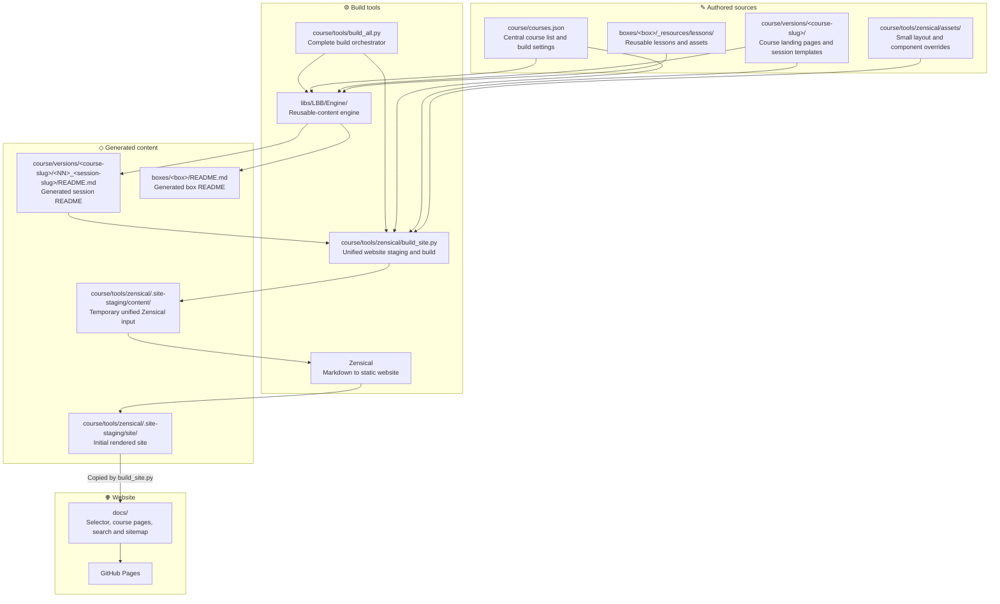

# Course websites

The course website is a static [Zensical](https://zensical.org/) site generated
from the repository's existing course content. Published courses live at
`https://noblackboxes.github.io/LastBlackBox/<course-slug>/`, where a course
slug is the short folder and URL name, such as `braitenberg`.

One Zensical project contains the selector and every published course. Zensical
provides the page frame, navigation, breadcrumbs, site-wide search, page outline,
light/dark themes, callouts and video rendering. The LBB scripts remain
responsible for assembling reusable lessons, calculating each curriculum and
rewriting repository links.

The public site is
[`https://noblackboxes.github.io/LastBlackBox/`](https://noblackboxes.github.io/LastBlackBox/).
Authored and generated Markdown remains under `course/` and `boxes/`; the final
local deployment artifact is `docs/`.

## Architecture



### Build sequence

The architecture diagram shows ownership and data flow. The sequence below
shows the order in which the complete build runs:

```mermaid
sequenceDiagram
    actor Runner as Developer or GitHub Actions
    participant Build as build_all.py
    participant Courses as generate_courses.py
    participant Config as LBB.config
    participant CourseList as course/courses.json
    participant Engine as LBB Engine
    participant Site as zensical/build_site.py
    participant Zensical
    participant Output as docs/

    Runner->>Build: Run the complete build
    Build->>Courses: Regenerate course content
    Courses->>Config: Import course configuration
    Config->>CourseList: Load and validate the central course list
    CourseList-->>Config: Enabled courses and course slugs

    loop Each course with generate = true
        Courses->>Engine: Load and render the course
        Note right of Engine: Read session templates and expand reusable lessons
        Engine-->>Courses: Rendered session Markdown
        Courses->>Courses: Write session README.md files
    end

    Courses->>Engine: Render the full reference course
    Engine-->>Courses: Rendered box Markdown
    Courses->>Courses: Write boxes/&lt;box&gt;/README.md files
    Courses-->>Build: Content generation complete

    Build->>Site: Build the unified website
    Site->>Config: Import course configuration
    Config->>CourseList: Load and validate the central course list
    CourseList-->>Config: Published courses and metadata
    Site->>Site: Stage selector, landing pages, sessions and assets
    Site->>Site: Rewrite links, materials blocks and Vimeo videos
    Site->>Zensical: Build the staged project in strict mode
    Zensical-->>Site: Render .site-staging/site/
    Site->>Output: Replace docs/ with the rendered site
    Site-->>Build: Website build complete
    Build-->>Runner: Complete deployable website
```

The authored course-level `README.md` is a repository-facing overview. It is
not used to generate the website or session content. Session templates are the
authority for generated session READMEs and for the website's open-box map.

## File ownership

| Path | Ownership | Written or assembled by | Purpose |
|---|---|---|---|
| `course/versions/<course-slug>/README.md` | Authored | Course author | Repository-facing overview and descriptive schedule. |
| `course/versions/<course-slug>/<NN>_<session-slug>/_resources/template.md` | Authored | Course author | Session structure containing `{Box:Lesson}` lesson tags. |
| `course/versions/<course-slug>/<NN>_<session-slug>/README.md` | Generated | LBB engine | Generated session Markdown; do not edit directly. |
| `boxes/<box>/README.md` | Generated | LBB engine | Full-reference Markdown for one black box; do not edit directly. |
| `course/versions/<course-slug>/index.md` | Optional authored override | Course author; assembled by `build_site.py` | Course landing-page body. |
| `course/versions/<course-slug>/site/` | Optional authored assets | Course author; staged by `build_site.py` | Partner logo and metadata. |
| `course/courses.json` | Authored configuration | Maintainer | Course registration, generation and publishing. |
| `pyproject.toml` | Authored configuration | Maintainer | Direct website-build dependencies and supported Python versions. |
| `.python-version` | Authored configuration | Maintainer | Python version used by uv locally and in CI. |
| `uv.lock` | Generated and committed | uv | Exact cross-platform dependency versions for reproducible builds. |
| `course/tools/zensical/assets/` | Shared authored assets | Maintainer; copied by `build_site.py` | Small CSS additions for readable layout, videos and LBB-specific components. |
| `course/tools/zensical/catalogue/` | Optional authored assets | Maintainer; staged by `build_site.py` | Per-course logos used by the root catalogue. |
| `course/tools/zensical/.site-staging/` | Generated temporary content | `build_site.py` and Zensical | Complete Zensical input plus the initial output under `.site-staging/site/`. |
| `docs/` | Generated output | Copied from `.site-staging/site/` by `build_site.py` | GitHub Pages artifact; never edit directly. |

## Local setup

Run commands from the repository root. Install
[uv](https://docs.astral.sh/uv/getting-started/installation/), then create the
locked Python 3.11 environment:

```bash
uv sync --locked
```

The same command works on Linux, macOS and Windows. `pyproject.toml` declares
the direct dependency and supported Python range; `.python-version` selects
Python 3.11; and `uv.lock` fixes the complete rendering environment.

Build all generated course content and every published website:

```bash
uv run --locked python course/tools/build_all.py
```

Rebuild the website without regenerating the engine-owned READMEs:

```bash
uv run --locked python course/tools/zensical/build_site.py
```

Plain `zensical build` from the repository root fails because there is
intentionally no committed root `zensical.toml` or standalone Zensical content
tree. `build_site.py` generates both under
`course/tools/zensical/.site-staging/` after assembling course content and
rewriting links.

For debugging an already staged project, this lower-level command works after
`build_site.py` has created the staging directory:

```bash
uv run --locked zensical build \
  --config-file course/tools/zensical/.site-staging/zensical.toml \
  --clean --strict
```

This lower-level command rebuilds only the content already in staging. It does
not restage repository sources or copy its output from
`course/tools/zensical/.site-staging/site/` into `docs/`. The supported Python
commands above perform those steps and produce the deployable artifact.

Preview the complete generated site:

```bash
uv run --locked python -m http.server -d docs 8000
```

Then open `http://localhost:8000/`. The server is needed because search and
other browser features do not work reliably when HTML is opened as local files.

## Authoring

### Sessions and reusable lessons

Each session lives under
`course/versions/<course-slug>/<NN>_<session-slug>/_resources/template.md`.
The engine replaces each standalone `{BoxName:LessonName}` lesson tag with
content from `boxes/<box>/_resources/lessons/<LessonName>.md`, then writes the
generated session `README.md` beside `_resources/`.

The complete content hierarchy, file formats, granularity rules and new-course
checklist are documented in the [course engine guide](../engine/README.md).

Edit the template or reusable lesson, never the generated session README. After
editing, regenerate content with:

```bash
uv run --locked python course/tools/engine/generate_courses.py
```

GitHub-style callouts are supported unchanged by GitHub and Zensical:

```markdown
> [!TIP]
> Helpful advice.
```

The engine emits GitHub-compatible materials blocks and linked GIF previews for
repository READMEs. During website staging, `build_site.py` converts those
exact blocks into a native collapsible table and Vimeo embeds, retaining the
public Vimeo link as a fallback. The generated repository READMEs are not
changed.

### Central course list

[`course/courses.json`](../../courses.json) is the single list of courses known
to the build. Each entry connects a course's human-readable name to its folder
under `course/versions/` and controls whether the engine, materials tools and
website include it:

```json
{
  "name": "Your Course",
  "engine_name": "Your Course",
  "slug": "your-course",
  "description": "One sentence shown on the root catalogue.",
  "logo": null,
  "generate": true,
  "materials": false,
  "published": true
}
```

- `name` supplies the course-site title and root catalogue label.
- `engine_name` identifies the course to the existing LBB engine and materials tools.
- `slug` matches the directory name and becomes the public URL path.
- `description` supplies catalogue text and fallback landing-page prose.
- `logo` optionally names a root-catalogue asset under `course/tools/zensical/catalogue/`.
- `generate` controls whether the engine writes the course's generated session
  READMEs.
- `materials` controls whether the separate BOM and packing-list tools process
  the course; those tools are not run by `build_all.py`.
- `published` controls whether the unified website includes the course.

Published or materials-enabled courses must also enable generation. The
configuration loader validates these rules and requires exactly one entry for
every course directory.

One engine operation is independent of the `generate` setting:
`generate_courses.py` always loads the course whose `engine_name` is
`The Last Black Box` to regenerate the top-level `boxes/<box>/README.md` files.

### Course landing page

An optional `course/versions/<course-slug>/index.md` supplies course-specific
landing content. Do not add an H1: the course's entry in
`course/courses.json` supplies it. Include exactly one
curriculum marker where the generated facts and 28-box grid should appear:

```markdown
## About this course

Course introduction.

<!-- LBB_CURRICULUM_MAP -->
```

Session links use `sessions/<NN>_<session-slug>/`. If `index.md` is absent,
`build_site.py` generates a basic landing page from the central course list and
discovered sessions.

To display a partner beneath the title, add:

```text
course/versions/<course-slug>/site/
  partner-logo.png          # or partner-logo.svg
  partner.json              # optional
```

`partner.json` may contain `url` and `label` strings. The build validates this
metadata and writes the markup at build time.

## Build behavior

`build_site.py` generates one Zensical project containing the root selector and
every published course. This gives the complete site one navigation hierarchy,
breadcrumb tree, search index and sitemap. The root and existing
`/<course-slug>/` course URLs are unchanged. Session pages now use
`/<course-slug>/sessions/<NN>_<session-slug>/`; the former Docfx URLs ending in
`/README.html` are not preserved or redirected. The build:

1. discovers numerically prefixed session directories;
2. generates the complete Zensical navigation from their template titles;
3. stages every landing page and session README as a folder index page;
4. adds website-only previous and next links that stop at course boundaries;
5. derives the curriculum from `{Box:Lesson}` lesson tags;
6. bundles repository images and rewrites non-image repository links to GitHub;
7. converts Vimeo thumbnail blocks to native video embeds;
8. writes the selector and crawler configuration;
9. uses the locked Zensical environment in strict mode to generate the site,
   search index and sitemap under `.site-staging/site/`, then replaces `docs/`
   with that output.

The generated `zensical.toml` deliberately uses Zensical's native modern theme,
navigation, breadcrumbs, search, page outline, palette and sitemap generation.
The shared `assets/stylesheets/extra.css` provides the remaining LBB-specific
content width, video sizing, catalogue cards, partner branding and curriculum
grid. There are no custom JavaScript files or page-template overrides.

## CI and deployment

[`deploy-docs.yml`](../../../.github/workflows/deploy-docs.yml) installs the
locked uv environment and runs `build_all.py`. Pull requests build and validate
the complete site without deploying. Pushes to `master` and, temporarily, the
`course-site-zensical` preview branch publish `docs/` to GitHub Pages.
The workflow uploads `docs/` as the Pages artifact; `.site-staging/` is never
deployed.

The repository must have **Settings → Pages → Source** set to **GitHub Actions**.
