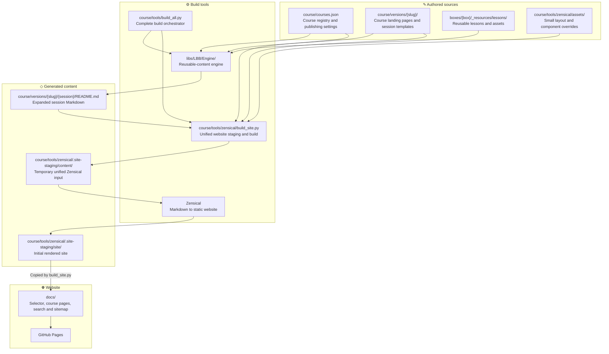

# Course websites

The course website is a static [Zensical](https://zensical.org/) site generated
from the repository's existing course content. Published courses live at
`https://noblackboxes.github.io/LastBlackBox/<slug>/`.

One Zensical project contains the selector and every published course. Zensical
provides the page frame, navigation, breadcrumbs, site-wide search, page outline,
light/dark themes, callouts and video rendering. The LBB scripts remain
responsible for assembling reusable lessons, calculating each curriculum and
rewriting repository links.

The public site is
[`https://noblackboxes.github.io/LastBlackBox/`](https://noblackboxes.github.io/LastBlackBox/).
Authored and generated Markdown remains under `course/` and `boxes/`; the final
local deployment artifact is `docs/`.

## Architecture



The authored course-level `README.md` is a repository-facing overview. It is
not used to generate the website or session content. Session templates are the
authority for generated session READMEs and for the website's open-box map.

## File ownership

| Path | Ownership | Written or assembled by | Purpose |
|---|---|---|---|
| `course/versions/<slug>/README.md` | Authored | Course author | Repository-facing overview and descriptive schedule. |
| `course/versions/<slug>/<NN>_*/_resources/template.md` | Authored | Course author | Session structure containing `{Box:Lesson}` tags. |
| `course/versions/<slug>/<NN>_*/README.md` | Generated | LBB engine | Expanded session Markdown; do not edit directly. |
| `course/versions/<slug>/index.md` | Optional authored override | Course author; assembled by `build_site.py` | Course landing-page body. |
| `course/versions/<slug>/site/` | Optional authored assets | Course author; staged by `build_site.py` | Partner logo and metadata. |
| `course/courses.json` | Authored configuration | Maintainer | Course registration, generation and publishing. |
| `course/tools/zensical/assets/` | Shared authored assets | Maintainer; copied by `build_site.py` | Small CSS additions for readable layout, videos and LBB-specific components. |
| `course/tools/zensical/catalogue/` | Optional authored assets | Maintainer; staged by `build_site.py` | Per-course logos used by the root catalogue. |
| `course/tools/zensical/.site-staging/` | Generated temporary content | `build_site.py` and Zensical | Complete Zensical input plus the initial output under `.site-staging/site/`. |
| `docs/` | Generated output | Copied from `.site-staging/site/` by `build_site.py` | GitHub Pages artifact; never edit directly. |

## Local setup

Run commands from the repository root. Zensical is pinned in
[`requirements.txt`](requirements.txt).

```bash
python3 -m venv .venv
.venv/bin/python -m pip install -r course/tools/zensical/requirements.txt
```

Build all generated course content and every published website:

```bash
.venv/bin/python course/tools/build_all.py
```

Rebuild the website without regenerating the engine-owned READMEs:

```bash
.venv/bin/python course/tools/zensical/build_site.py
```

Plain `zensical build` from the repository root fails because there is
intentionally no committed root `zensical.toml` or standalone Zensical content
tree. `build_site.py` generates both under
`course/tools/zensical/.site-staging/` after assembling course content and
rewriting links.

For debugging an already staged project, this lower-level command works after
`build_site.py` has created the staging directory:

```bash
.venv/bin/zensical build \
  --config-file course/tools/zensical/.site-staging/zensical.toml \
  --clean --strict
```

This lower-level command rebuilds only the content already in staging. It does
not restage repository sources or copy its output from
`course/tools/zensical/.site-staging/site/` into `docs/`. The supported Python
commands above perform those steps and produce the deployable artifact.

Preview the complete generated site:

```bash
.venv/bin/python -m http.server -d docs 8000
```

Then open `http://localhost:8000/`. The server is needed because search and
other browser features do not work reliably when HTML is opened as local files.

## Authoring

### Sessions and reusable lessons

Each session lives under
`course/versions/<slug>/<NN>_<session>/_resources/template.md`. The engine
replaces every `{BoxName:LessonName}` tag with content from
`boxes/<box>/_resources/lessons/<LessonName>.md` and writes the session
`README.md` beside `_resources/`.

Edit the template or reusable lesson, never the generated session README. After
editing, regenerate content with:

```bash
.venv/bin/python course/tools/engine/generate_courses.py
```

GitHub-style callouts are supported unchanged by GitHub and Zensical:

```markdown
> [!TIP]
> Helpful advice.
```

The engine emits GitHub-compatible materials blocks and linked GIF previews for
repository READMEs. During website staging, `build_site.py` converts those
exact blocks into a native collapsible table and Vimeo embeds, retaining the
public Vimeo link as a fallback. The generated repository READMEs are not
changed.

### Course manifest

Register every directory under `course/versions/` in the single manifest,
[`course/courses.json`](../../courses.json):

```json
{
  "name": "Your Course",
  "engine_name": "Your Course",
  "slug": "your-course",
  "description": "One sentence shown on the root catalogue.",
  "logo": null,
  "generate": true,
  "materials": false,
  "published": true
}
```

- `name` supplies the course-site title and root catalogue label.
- `engine_name` identifies the course to the existing LBB engine and materials tools.
- `slug` matches the directory name and becomes the public URL path.
- `description` supplies catalogue text and fallback landing-page prose.
- `logo` optionally names a root-catalogue asset under `course/tools/zensical/catalogue/`.
- `generate`, `materials` and `published` control their respective build stages.

Published or materials-enabled courses must also enable generation. The
manifest loader validates these rules and requires exactly one entry for every
course directory.

### Course landing page

An optional `course/versions/<slug>/index.md` supplies course-specific landing
content. Do not add an H1: the manifest supplies it. Include exactly one
curriculum marker where the generated facts and 28-box grid should appear:

```markdown
## About this course

Course introduction.

<!-- LBB_CURRICULUM_MAP -->
```

Session links use `sessions/<NN>_<session>/`. If `index.md` is absent,
`build_site.py` generates a basic landing page from the manifest and discovered
sessions.

To display a partner beneath the title, add:

```text
course/versions/<slug>/site/
  partner-logo.png          # or partner-logo.svg
  partner.json              # optional
```

`partner.json` may contain `url` and `label` strings. The build validates this
metadata and writes the markup at build time.

## Build behavior

`build_site.py` generates one Zensical project containing the root selector and
every published course. This gives the complete site one navigation hierarchy,
breadcrumb tree, search index and sitemap while preserving the existing
`/<slug>/` and `/<slug>/sessions/<session>/` URLs. It:

1. discovers numerically prefixed session directories;
2. generates the complete Zensical navigation from their template titles;
3. stages every landing page and session README as a folder index page;
4. derives the curriculum from `{Box:Lesson}` tags;
5. bundles repository images and rewrites non-image repository links to GitHub;
6. converts Vimeo thumbnail blocks to native video embeds;
7. writes the selector and crawler configuration;
8. uses the pinned Zensical version in strict mode to generate the site, search
   index and sitemap under `.site-staging/site/`, then replaces `docs/` with
   that output.

The generated `zensical.toml` deliberately uses Zensical's native modern theme,
navigation, breadcrumbs, search, page outline and palette. There are no custom
JavaScript files or template overrides.

## CI and deployment

[`deploy-docs.yml`](../../../.github/workflows/deploy-docs.yml) installs the
pinned requirements and runs `build_all.py`. Pull requests build and validate
the complete site without deploying. Pushes to `master` and, temporarily, the
`course-site-zensical` preview branch publish `docs/` to GitHub Pages.
The workflow uploads `docs/` as the Pages artifact; `.site-staging/` is never
deployed.

The repository must have **Settings → Pages → Source** set to **GitHub Actions**.
